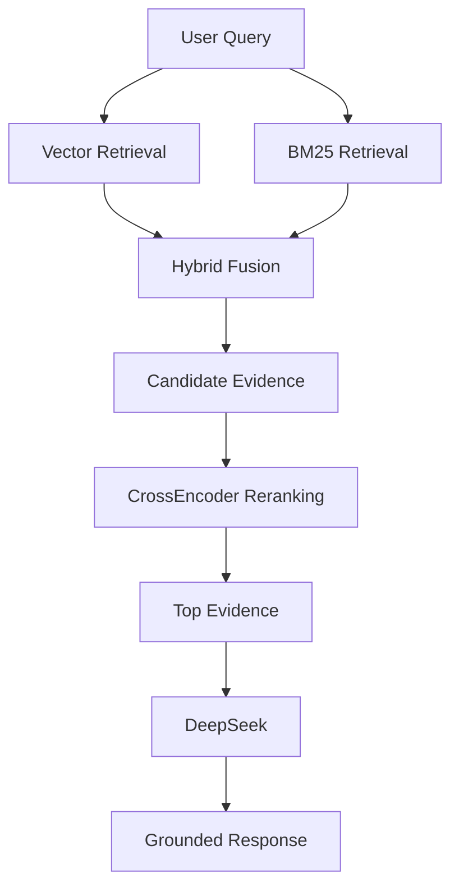
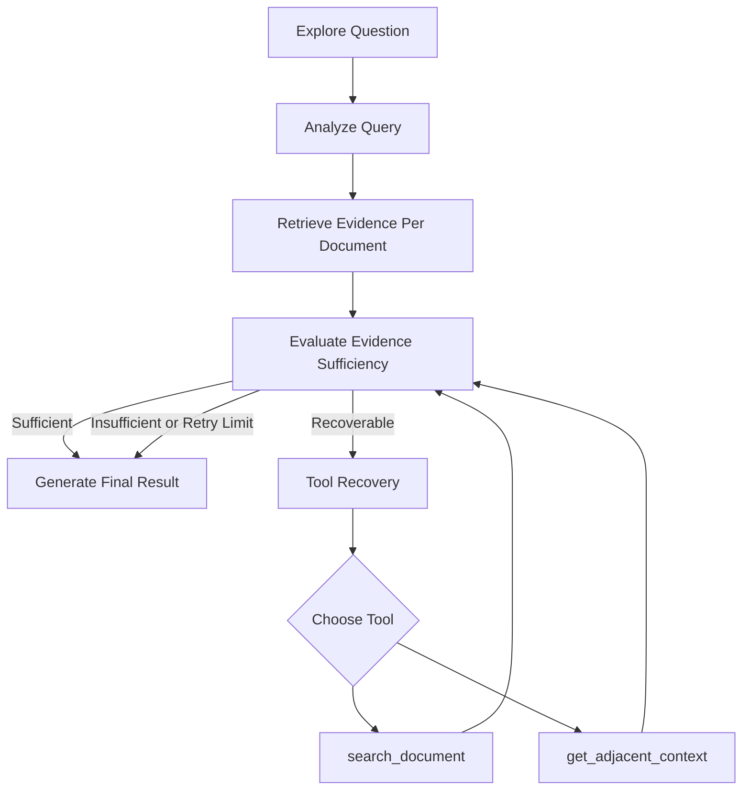
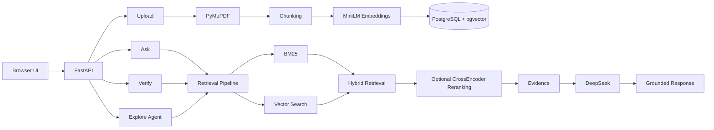

# 🔎 LitLens

<p align="center">
  <strong>Evidence-grounded RAG for research papers with hybrid retrieval, claim verification, and agentic multi-document exploration.</strong>
</p>

<p align="center">
  <a href="https://litlens-3rq3.onrender.com"><strong>🌐 Live Demo</strong></a>
  ·
  <a href="https://github.com/yuehanhu0527-pixel/litlens"><strong>💻 GitHub</strong></a>
</p>

<p align="center">
  
  
  
  
  
  
  
</p>

---

## ✨ Overview

**LitLens** is an evidence-grounded research paper assistant built to make retrieval, verification, and multi-document comparison more transparent.

Instead of asking an LLM to answer directly from its own knowledge, LitLens retrieves evidence from uploaded papers first and then generates answers grounded in that evidence.

It supports three core workflows:

| Mode | Purpose |
|---|---|
| **Ask** | Answer questions using evidence retrieved from selected papers |
| **Verify** | Classify a claim as `SUPPORTED`, `CONTRADICTED`, or `INSUFFICIENT` |
| **Explore** | Compare and synthesize evidence across multiple papers using a LangGraph agent |

The project combines **RAG, hybrid retrieval, pgvector, BM25, reranking, agentic recovery, citation integrity, evaluation, backend engineering, and multi-user session isolation** in one system.

---

## 🌐 Live Demo

**https://litlens-3rq3.onrender.com**

> The current demo is hosted on Render and uses Neon PostgreSQL.  
> Small cloud instances may occasionally restart under transformer-model memory pressure. The local version supports the full retrieval and reranking pipeline.

---

## 🎯 Why LitLens?

Many document Q&A systems can produce fluent answers, but several important questions remain difficult to inspect:

- Which document actually supports a statement?
- Was the cited passage really retrieved?
- Do multiple papers agree or disagree?
- Is the available evidence sufficient?
- What should the system do when retrieval is incomplete?

LitLens is built around one principle:

> **Retrieve evidence first. Generate or verify from that evidence second.**

Evidence IDs and document attribution are preserved throughout the workflow so that answers remain inspectable.

---

# 🚀 Features

## 1. Evidence-Grounded Ask

Users can upload research papers, select a document scope, and ask questions.

```text
Question
   ↓
Hybrid Retrieval
   ↓
Relevant Evidence
   ↓
Grounded LLM Answer
```

Answers return evidence references instead of relying only on the LLM's internal knowledge.

---

## 2. Claim Verification

LitLens evaluates claims against retrieved evidence and returns:

```text
SUPPORTED
CONTRADICTED
INSUFFICIENT
```

A verification response includes:

- verdict
- confidence
- reasoning
- evidence IDs

This makes claim verification inspectable rather than returning only a yes/no answer.

---

## 3. Multi-Document Explore

Explore handles questions such as:

- Do these papers agree?
- How do their conclusions differ?
- What evidence does each paper provide?
- Which paper provides stronger support?
- Where is the evidence insufficient?

Explore uses a **LangGraph agent** because cross-document research may require adaptive retrieval and recovery.

---

# 🧠 Retrieval Architecture

LitLens uses both semantic and lexical retrieval.



---

## Vector Retrieval

Research paper chunks are embedded using:

```text
sentence-transformers/all-MiniLM-L6-v2
```

The model produces **384-dimensional embeddings**.

Embeddings are stored in PostgreSQL using:

```text
pgvector
```

This enables semantic similarity search between a user query and document chunks.

---

## BM25 Retrieval

LitLens also performs lexical retrieval using BM25.

BM25 helps when exact terms matter, including:

- terminology
- names
- technical phrases
- specific wording

---

## Hybrid Retrieval

Vector retrieval and BM25 results are combined into a shared candidate set.

This allows LitLens to benefit from:

```text
Semantic similarity
        +
Lexical matching
```

rather than relying on only one retrieval method.

---

## CrossEncoder Reranking

Candidate passages can be reranked using:

```text
cross-encoder/ms-marco-MiniLM-L-6-v2
```

The CrossEncoder evaluates the query and passage together before selecting the final evidence.

For memory-constrained deployments, reranking can be disabled with:

```text
ENABLE_RERANKER=false
```

The local version can continue using the full reranking pipeline.

---

# 🤖 Agentic Explore

Ask and Verify use deterministic pipelines.

Explore uses a LangGraph agent because multi-document comparison may require adaptive decision-making.



The workflow uses **bounded retries** to avoid uncontrolled agent loops.

---

## Agent Tools

### `search_document`

Runs another retrieval query inside a specific paper.

Useful when the initial query does not retrieve enough evidence.

### `get_adjacent_context`

Retrieves nearby chunks from the same page and document.

Useful when the correct passage is found but additional surrounding context is needed.

---

# 🧩 Why Ask and Verify Are Not Agents

LitLens intentionally separates deterministic workflows from agentic workflows.

### Ask / Verify

```text
Request
   ↓
Retrieve
   ↓
Rerank
   ↓
Generate / Verify
```

These workflows are already well-defined by the user's selected mode.

Adding an agent would introduce unnecessary complexity.

### Explore

Explore may need to:

- infer comparison intent
- evaluate evidence sufficiency
- decide whether retrieval should continue
- select a recovery tool
- preserve conflicting findings
- stop when evidence remains insufficient

Agentic behavior is therefore used only where adaptive decision-making adds value.

---

# 📚 Evidence Integrity

Every retrieved evidence item can preserve fields such as:

```text
document_id
filename
page_number
chunk_index
text
evidence_id
```

This allows LitLens to track where evidence originated and prevents citations from being detached from retrieved passages.

---

# 🧪 Evaluation

LitLens includes multiple evaluation layers covering retrieval scope, agent recovery, grounding, citation integrity, and answer quality.

### Current Designed Test Suite

| Evaluation | Result |
|---|---:|
| Regression evaluation | **6 / 6 passed** |
| Agent recovery evaluation | **3 / 3 passed** |
| Grounding & citation integrity | **8 / 8 passed** |
| Rubric-based answer quality | **3 / 3 passed** |

> These results describe the current designed evaluation suite.  
> They should **not** be interpreted as 100% real-world accuracy.

---

## Evaluation Coverage

The current tests cover:

- document scoping
- Ask correctness
- Verify correctness
- irrelevant-document handling
- selective agent recovery
- bounded retries
- citation integrity
- attribution correctness
- conflict preservation
- insufficient-evidence handling
- multi-document answer quality

---

## Agent Recovery Tests

### Recoverable Evidence

```text
Initial evidence incomplete
        ↓
Recovery tool called
        ↓
Additional evidence retrieved
        ↓
Evidence becomes sufficient
```

### Irrelevant Document

```text
No useful evidence
        ↓
No unnecessary recovery loop
        ↓
Document remains insufficient
```

### Already Sufficient Evidence

```text
Initial evidence sufficient
        ↓
No recovery call
```

---

# 🔐 Session-Isolated Workspaces

LitLens supports anonymous browser workspaces.

Each browser receives a session ID stored in:

```text
localStorage
```

Requests send:

```text
X-Session-ID
```

The backend validates document ownership before allowing:

- document listing
- Ask
- Verify
- Explore
- deletion

A user cannot access another session's document simply by guessing its document ID.

---

# 🛡️ Public Demo Hardening

## Maximum 10 Active Papers

Each anonymous workspace can contain up to:

```text
10 documents
```

Users can remove old papers and upload replacements.

---

## 20 MB Upload Limit

Each PDF is limited to:

```text
20 MB
```

Oversized files are rejected before parsing and embedding.

---

## Session-Specific File Storage

Files are separated by session:

```text
data/
├── session-a/
│   └── paper.pdf
│
└── session-b/
    └── paper.pdf
```

This allows different users to upload files with identical names without overwriting each other.

---

## 24-Hour Automatic Cleanup

Anonymous documents expire after:

```text
24 hours
```

Cleanup removes:

- the `Document` record
- associated chunks through cascading deletion
- the original PDF file

---

# 🏗️ System Architecture



---

# 🛠️ Tech Stack

## Backend

- Python
- FastAPI
- Pydantic
- SQLAlchemy

## Database

- PostgreSQL
- pgvector
- Neon

## Retrieval

- Sentence Transformers
- `all-MiniLM-L6-v2`
- BM25
- Hybrid retrieval
- CrossEncoder reranking

## Agent

- LangGraph
- LangChain Core tools
- LLM tool calling

## LLM

- DeepSeek
- OpenAI-compatible client

## PDF Processing

- PyMuPDF

## Frontend

- HTML
- CSS
- JavaScript

## Deployment

- GitHub
- Render
- Neon PostgreSQL

---

# 📁 Project Structure

```text
litlens/
├── app/
│   ├── main.py
│   ├── models.py
│   ├── database.py
│   ├── db_models.py
│   ├── pdf_parser.py
│   ├── chunker.py
│   ├── embeddings.py
│   ├── retrieval.py
│   ├── db_retrieval.py
│   ├── bm25_retrieval.py
│   ├── hybrid_retrieval.py
│   ├── reranker.py
│   ├── retrieval_pipeline.py
│   ├── multi_doc_retrieval.py
│   ├── evidence_utils.py
│   ├── llm.py
│   ├── explore.py
│   ├── agent_state.py
│   ├── agent_tools.py
│   ├── agent_nodes.py
│   └── explore_agent.py
│
├── frontend/
│   ├── index.html
│   ├── app.js
│   └── styles.css
│
├── eval_cases.py
├── run_evaluation.py
├── eval_agent_recovery.py
├── eval_grounding.py
├── eval_answer_quality.py
├── create_tables.py
├── requirements.txt
└── README.md
```

---

# 💻 Local Setup

## 1. Clone the Repository

```bash
git clone https://github.com/yuehanhu0527-pixel/litlens.git
cd litlens
```

## 2. Create a Virtual Environment

```bash
python -m venv .venv
source .venv/bin/activate
```

## 3. Install Dependencies

```bash
python -m pip install -r requirements.txt
```

---

## 4. Configure PostgreSQL

Create a local PostgreSQL database:

```text
litlens
```

Enable pgvector:

```sql
CREATE EXTENSION IF NOT EXISTS vector;
```

By default LitLens uses:

```text
postgresql+psycopg://localhost/litlens
```

You can also provide a cloud database:

```bash
export DATABASE_URL="postgresql+psycopg://..."
```

---

## 5. Configure DeepSeek

Create a `.env` file:

```text
DEEPSEEK_API_KEY=your_api_key
```

Do not commit `.env`.

---

## 6. Create Database Tables

```bash
python create_tables.py
```

---

## 7. Run LitLens

```bash
python -m uvicorn app.main:app --reload
```

Local development URL:

```text
http://127.0.0.1:8000
```

---

# 🧪 Running Evaluations

Regression evaluation:

```bash
python run_evaluation.py
```

Agent recovery evaluation:

```bash
python eval_agent_recovery.py
```

Grounding and citation evaluation:

```bash
python eval_grounding.py
```

Rubric-based answer quality evaluation:

```bash
python eval_answer_quality.py
```

---

# ☁️ Cloud Deployment

Current architecture:

```text
GitHub
   ↓
Render Web Service
   ↓
FastAPI
   ↓
Neon PostgreSQL + pgvector
```

Required environment variables:

```text
DATABASE_URL
DEEPSEEK_API_KEY
PYTHON_VERSION
```

Optional low-memory setting:

```text
ENABLE_RERANKER=false
```

Because LitLens performs local transformer inference, very small cloud instances may not provide enough memory for all models.

A larger instance is recommended for a stable production deployment.

---

# ⚠️ Current Limitations

LitLens is a portfolio-scale research system rather than a production document platform.

Current limitations include:

- transformer inference requires significant memory
- very small cloud instances may restart under memory pressure
- anonymous sessions are browser-based rather than account-based
- PDFs are intended as temporary workspace files
- the current evaluation suite is designed rather than a large external benchmark
- retrieval quality can vary with paper structure and query wording

---

# 🗺️ Future Improvements

Potential next steps include:

- hosted or optimized embedding inference
- larger retrieval evaluation datasets
- persistent object storage
- authenticated accounts
- richer evidence visualization
- streaming responses
- improved monitoring
- additional document formats
- retrieval/reranking ablation experiments

---

# 💡 Engineering Questions Explored

LitLens was built to explore practical AI engineering questions such as:

- When should hybrid retrieval be preferred over vector-only retrieval?
- Where does reranking add value?
- When is an agent useful compared with a deterministic pipeline?
- How can evidence attribution survive through an LLM workflow?
- What should an agent do when retrieval is incomplete?
- How should insufficient evidence be represented?
- How can multi-user RAG applications isolate document access?
- How can RAG and agent behavior be evaluated beyond a single demo?

---

## 📌 Repository

**GitHub:**  
https://github.com/yuehanhu0527-pixel/litlens

## 🌐 Demo

**LitLens:**  
https://litlens-3rq3.onrender.com

---

<p align="center">
  Built as a practical exploration of RAG, retrieval engineering, agent workflows, evaluation, and backend AI systems.
</p>